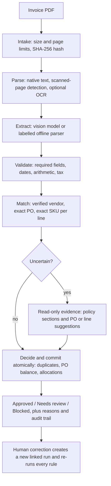

# ClearPay: invoice PDF to a reasoned AP decision

A runnable implementation of **PS-1 (Finance / AP): Invoice processing, from PDF to decision**, using synthetic data.

ClearPay takes a vendor invoice PDF and returns one of three decisions, **Approved**, **Needs review** or **Blocked**. Every decision lists coded reasons and a timed record of each step, so a reviewer can see what was read, what it was compared against, and why the result came out as it did.

> The code package, CLI command (`python -m invoiceiq`) and database names keep the original identifier `invoiceiq`.

The core principle: **a model reads the invoice; deterministic rules make the decision.** Extraction (a vision model, OCR or the offline parser) only produces data. Approval is decided by finance rules that run in a single database transaction. Retrieval and AI suggestions are advisory and can never approve anything.

---

## How it works



| Stage | What happens | Where |
|---|---|---|
| Intake | 10 MB and 10-page limits, PDF signature check, content hash | [workflow.py](invoiceiq/workflow.py) |
| Parse | PyMuPDF text; pages with little text, or mostly image, are flagged as scanned; optional Tesseract OCR | [extraction.py](invoiceiq/extraction.py) |
| Extract | Vision model: page images plus text, strict JSON, invoice text treated as untrusted. Offline parser: labelled synthetic format only. Missing values stay `null` and are never guessed. | [extraction.py](invoiceiq/extraction.py) |
| Validate | Required fields, ISO date not in the future, currency code, non-negative amounts, `qty × price = line`, `Σ lines = subtotal`, `subtotal + tax = total` within ₹0.01, optional allowed tax rates | [finance.py](invoiceiq/finance.py) |
| Match | Vendor by tax ID (name must agree), PO must exist, be open and belong to that vendor, each line matched by **exact SKU** | [finance.py](invoiceiq/finance.py), [retrieval.py](invoiceiq/retrieval.py) |
| Evidence | Only for uncertain cases: AP policy retrieval plus advisory PO and line candidates (bounded, read-only) | [workflow.py](invoiceiq/workflow.py) |
| Decide | Duplicate check, remaining PO amount and quantity, ±2% price tolerance, then insert the invoice and its allocations in one transaction | [finance.py](invoiceiq/finance.py) |

Orchestration uses a compiled LangGraph `StateGraph` with conditional routing (or a plain-Python fallback when `AGENT_ENABLED=0`).

### How outcomes are decided

Each finding has a severity, and the most severe one sets the outcome:

- **BLOCK**: we have *positive evidence* that paying is wrong: an unknown or unapproved vendor, a PO belonging to another vendor, or an invoice number or PDF this vendor has already had approved. A reviewer cannot override these.
- **REVIEW**: we *don't know enough* to pay safely: a missing field, broken arithmetic, missing PO or not found, a line matched only by description, price outside tolerance, PO balance or quantity exceeded, or an unreadable scan.
- **INFO**: shown for transparency; doesn't change the outcome (for example, tax-inclusive prices were converted to pre-tax before comparison, or a currency missing from the invoice was taken from the verified PO).

The distinction matters most where it is least obvious: *not being able to read a vendor* is REVIEW, while *reading a vendor we don't recognise* is BLOCK (see edge case 08).

---

## Edge cases

The rule checks in fixtures 01, 05, 06 and 07 are baseline behaviour. The four cases below were designed specifically to make the process behave differently from the happy path. All nine fixtures are in [fixtures/invoices](fixtures/invoices), produced by [scripts_generate_fixtures.py](scripts_generate_fixtures.py), and asserted in the tests.

### 1. One PO split across several invoices, with the last one overrunning (`02` → `03`)
**Scenario:** PO-1007 is for 40 chairs at ₹2,500 (₹1,00,000 pre-tax). The vendor bills it in parts: 10 chairs (01), then 26 chairs (02). Invoice 03 then bills 16 more.
**Why it is hard:** taken alone, invoice 03 is perfect: right vendor, right PO, right SKU, right price, arithmetic correct. It is only wrong given what has already been approved.
**Behaviour:** remaining PO amount, remaining quantity per line and remaining amount per line are calculated from *approved allocations only*, inside the same `BEGIN IMMEDIATE` transaction (an advisory lock on Postgres) that records the approval. Two concurrent invoices therefore cannot both use the last ₹10,000. → **Needs review** (`PO_CAPACITY_EXCEEDED`, `PO_QUANTITY_EXCEEDED`, `PO_LINE_BALANCE_EXCEEDED`). Rejected or reviewed invoices consume nothing.
**Why review, not block:** over-billing is often a legitimate PO amendment that hasn't been entered yet; a human should decide.

### 2. The same invoice sent again as a different PDF (`04`)
**Scenario:** the vendor re-sends INV-001 as a new PDF (re-exported, different bytes, so a different file hash).
**Why it is hard:** file-hash deduplication misses it, and invoice numbers vary in formatting (`INV-001`, `inv 001`, `INV/001`).
**Behaviour:** invoice numbers are normalised (uppercase, letters and digits only) and checked per vendor against approved invoices; the exact-file hash is checked as a second signal. Approvals are serialised (`BEGIN IMMEDIATE`, or an advisory lock on Postgres), so the normalised check always sees every earlier approval; a `UNIQUE(vendor_id, invoice_number)` constraint is a further safety net for simultaneous submissions. → **Blocked** (`DUPLICATE_INVOICE`).
**Why block:** paying the same invoice twice is the costliest mistake in AP, and there is positive evidence of it.

### 3. A scanned invoice in a different vendor layout (`08`)
**Scenario:** an image-only scan (slightly rotated, blurred, speckled) in a real-looking vendor layout: letterhead, "Your Order Ref" instead of "PO Number", "Dated 12-Nov-2026", a table and an IGST line. There is no text layer.
**Why it is hard:** a naive pipeline extracts nothing and then reports "unknown vendor, missing PO", which either *blocks a genuine supplier* or, worse, hides that nothing was read.
**Behaviour:**
- **Offline, no OCR or model:** the page is detected as scanned and the pipeline sets `SCANNED_NO_TEXT` itself; the model cannot set or clear this flag. The result is **Needs review** with `UNREADABLE_SCAN` and `VENDOR_NOT_EXTRACTED`, explicitly *not* `UNKNOWN_VENDOR`. A reviewer can key in the values; that creates a new linked run, and every rule, including duplicates, is re-applied.
- **With a vision model** (verified with `gemini-3.1-flash-lite`, about 6 s): every header field and the line item are read correctly from the image, including "Your Order Ref" → `po_number` and "12-Nov-2026" → `2026-11-12`, each with page-level source evidence. The invoice prints no currency, so the model returns `null` rather than guessing; the verified PO's currency (INR) is then used and recorded as an INFO note `CURRENCY_FROM_PO`. → **Approved**. This is safe because the PO is an exact verified match, and amounts in another currency would fail the ±2% price check (tested).

### 4. GST-inclusive line prices (`09`)
**Scenario:** a realistic Indian tax invoice from Nova bills 2 desks at **₹7,080 each in a "Rate (incl. GST)" column**, with the note "All prices are inclusive of GST @ 18%" and a tax summary (taxable value ₹12,000, CGST 9% + SGST 9% = ₹2,160, total ₹14,160). The PO price is ₹6,000 *pre-tax*. Nothing on the page says "prices include tax: yes"; the reader has to infer it.
**Why it is hard:** comparing the printed price with the PO price shows an 18% variance, and the invoice gets wrongly sent to review. Worse, the PO balance is consumed at ₹14,160 instead of ₹12,000, so later legitimate invoices fail.
**Behaviour:** extraction records `prices_include_tax`. Gross lines must add up to the *total*, and `subtotal + tax = total` must hold; each line's pre-tax value is then `price × subtotal ÷ total`. Price tolerance and PO line balance use the pre-tax value, and the allocation records ₹12,000. → **Approved**, with an INFO finding `TAX_INCLUSIVE_NORMALISED`. The vision model infers `prices_include_tax` from the layout and reads `12/11/2026` as 12 November (verified with `gemini-3.1-flash-lite`). Offline, the labelled parser cannot read this layout, so the invoice goes to **Needs review** instead of being guessed at. The tests also show:
- the same invoice read naively → `PRICE_VARIANCE`;
- a tax-inclusive *overcharge* (₹7,300 incl. GST = ₹6,186 pre-tax, +3.1%) → still caught;
- gross lines that don't add up → review.

### All fixtures

Expected results when processed **in this order on a fresh database**:

| # | Fixture | Result | Key findings |
|---|---|---|---|
| 01 | happy path, 10 chairs | Approved | – |
| 04 | same invoice, different PDF | Blocked | `DUPLICATE_INVOICE` |
| 02 | partial PO, 26 chairs | Approved | – |
| 03 | 16 more chairs, PO overrun | Needs review | `PO_CAPACITY_EXCEEDED`, `PO_QUANTITY_EXCEEDED`, `PO_LINE_BALANCE_EXCEEDED` |
| 05 | PO number blank | Needs review | `PO_MISSING` (plus policy and PO suggestions) |
| 06 | unapproved vendor | Blocked | `UNAPPROVED_VENDOR`, `PO_VENDOR_MISMATCH` |
| 07 | wrong SKU, similar description | Needs review | `LINE_IDENTITY_UNVERIFIED` (a matching description never stands in for a SKU) |
| 08 | scanned, different layout | Needs review offline; **Approved** with the vision model | offline: `UNREADABLE_SCAN`, `VENDOR_NOT_EXTRACTED`; model: `CURRENCY_FROM_PO` (INFO) |
| 09 | GST-inclusive prices, realistic layout | Needs review offline; **Approved** with the vision model | offline: `MISSING_FIELD`, `VENDOR_NOT_EXTRACTED`; model: `TAX_INCLUSIVE_NORMALISED` (INFO) |

Run it yourself:

```powershell
$env:SUPABASE_DB_URL=""; $env:INVOICEIQ_DB="demo.sqlite"   # local, throwaway database
python -m invoiceiq seed
foreach ($f in "01_happy_path","04_same_invoice_different_pdf","02_partial_po_65k","03_po_over_capacity","05_missing_po","06_unapproved_vendor","07_wrong_sku","08_scanned_different_layout","09_gst_inclusive_pricing") {
  python -m invoiceiq process "fixtures/invoices/$f.pdf" --mode fixture }
```

---

## Quick start

Python 3.11+ (tested on 3.14 / Windows).

```bash
python -m venv .venv
# Windows: .venv\Scripts\Activate.ps1    Linux/macOS: source .venv/bin/activate
pip install -r requirements-lock.txt      # or requirements.txt for version ranges
python scripts_generate_fixtures.py       # regenerates fixtures/invoices
streamlit run app.py
```

In the sidebar click **Seed demo procurement database**, upload a fixture and choose extraction mode `fixture` (or `auto` with no vision model configured). The dashboard shows the decision, the reasons, extracted fields, line items, retrieved evidence, a stage timeline and history; reviewers can correct a run that needs review.

### Deploy to Streamlit Community Cloud

1. Push this repository to GitHub (`.env` and `*.sqlite` are git-ignored; never commit secrets).
2. At [share.streamlit.io](https://share.streamlit.io), click **Create app**, pick the repo and branch, set **Main file path** to `app.py`, and under **Advanced settings** choose Python 3.12.
3. In **Advanced settings → Secrets**, paste the contents of [.streamlit/secrets.toml.example](.streamlit/secrets.toml.example) with real values. `SUPABASE_DB_URL` must be the **Session pooler** connection string (`postgresql://…pooler.supabase.com:5432/postgres`), not the `https://…supabase.co` project URL. Without it the app uses a temporary SQLite file that is wiped whenever the app restarts or sleeps.
4. Deploy, open the app and click **Seed demo procurement database** once.
5. Before a demo, clear earlier runs so fixture 01 isn't a duplicate. Run this locally with the same `SUPABASE_DB_URL` in `.env`: `python -m invoiceiq reset`.

Sample PDFs can be downloaded from the app's **Demo Inputs & Policies** tab. The deployed app has no login: anyone with the URL can process invoices on the configured Gemini key.

**CLI**

```bash
python -m invoiceiq seed
python -m invoiceiq reset    # delete all runs and approvals, then re-seed (demo data only)
python -m invoiceiq process fixtures/invoices/01_happy_path.pdf --mode fixture   # auto | fixture | vision
```

**API**

```bash
uvicorn invoiceiq.api:app --reload
curl -X POST http://127.0.0.1:8000/process -H 'Content-Type: application/pdf' -H 'X-Filename: happy.pdf' \
     --data-binary @fixtures/invoices/01_happy_path.pdf
```

Endpoints: `POST /process`, `GET /runs`, `GET /runs/{id}`, `GET /runs/{id}/pdf`, `POST /runs/{id}/review`.
⚠️ There is no authentication or tenant isolation, and the reviewer identity is a demo header. Bind to localhost only.

**Tests**

```bash
python -m pytest -q --basetemp=.pytest-tmp
```

---

## Configuration

Settings are read from `.env` (loaded automatically; see [.env.example](.env.example)). **Never commit `.env`.**

| Setting | Effect |
|---|---|
| `SUPABASE_DB_URL` | When set, the dashboard, API, CLI, PDF storage and caches all use Supabase Postgres (tables in an `invoiceiq` schema). Use the Session pooler URI with the password URL-encoded. When empty, SQLite at `INVOICEIQ_DB` (default `invoiceiq.sqlite`) is used. Tests always unset it and never write to Supabase. |
| `OPENAI_COMPATIBLE_BASE_URL` / `_API_KEY` / `_MODEL` | Vision extraction through any OpenAI-compatible `/chat/completions` endpoint that accepts images (for example Gemini's OpenAI-compatible API). With `_MODEL` set, `auto` uses the model. Invalid or failed responses are recorded as `ERROR` and never approved. |
| `OCR_ENABLED=1` | Uses Tesseract (must be installed) for scanned pages. |
| `ALLOWED_TAX_RATES` | e.g. `5,12,18`: tax must equal one of these rates applied to the subtotal. Unset means arithmetic only; this is not a tax compliance engine. |
| `EMBEDDINGS_ENABLED`, `EMBEDDING_BACKEND` (`local`/`remote`), `EMBEDDING_MODEL`, `EMBEDDING_API_URL`, `EMBEDDING_API_KEY`, `RERANKER_MODEL` | BGE-M3 embeddings for policy retrieval and line suggestions, either local (`requirements-ai.txt`) or a hosted endpoint returning 1024-dimensional vectors. Vectors are cached by model, provider and content hash. When disabled, lexical retrieval is used. |
| `AGENT_ENABLED` | `1` (default) uses LangGraph; `0` uses the plain-Python route. |

Extraction results are cached under a key built from the document hash, mode, endpoint, model and OCR setting. Finance checks **always** run fresh.

---

## Finance assumptions (synthetic)

- PO amounts and PO line prices are **pre-tax**, in INR. `subtotal` is the pre-tax amount and `total = subtotal + tax`.
- To be approved, an invoice needs a verified and approved vendor, an exact open PO for that vendor, and an exact SKU match on every line. Description similarity only produces suggestions.
- Unit price tolerance is ±2% (pre-tax). Quantity and amount may not exceed what remains on the PO line, and the subtotal may not exceed what remains on the PO.
- Only approved invoices consume PO balance. Approval and allocation happen in one transaction.
- Out of scope: credit notes, payments, currency conversion, changes to supplier bank details, three-way goods-receipt matching, tax-inclusive POs, statutory tax validation.

---

## What is verified

- **Real vision-model runs** (`gemini-3.1-flash-lite` through Gemini's OpenAI-compatible endpoint): fixture 08, an image-only scan → Approved, all fields correct; fixture 09, a GST-inclusive invoice in a realistic layout → Approved, tax-inclusive pricing inferred without any explicit label. That is two documents, not an accuracy benchmark; see the evaluation plan below.
- **77 automated tests pass** (Python 3.14 / Windows). They cover real fixture PDFs from upload to decision (all nine fixtures), LangGraph routing, concurrent duplicate and capacity races, persisted human corrections, extraction-cache reuse with fresh finance checks, scanned-page detection, model failures and invalid model output (simulated), a model attempting to set pipeline flags, tax-inclusive normalisation, and the Streamlit first render.
- The API is exercised end-to-end through FastAPI's test client (process, read back, review).
- **Not verified in this repository:** vision-model accuracy across many real supplier invoices, Tesseract OCR, downloading BGE-M3 and the reranker, live Supabase concurrency. Model calls in tests use explicitly labelled mock transports, which the application itself never uses.

## Evaluation plan for the extraction model

Benchmark at least 30 unseen invoices (native text, scanned, tax-inclusive and multi-page) and measure:
- exact accuracy of header fields;
- line-item F1;
- correctness of totals;
- decision accuracy;
- **unsafe approval rate** (the metric that matters most);
- p50/p95 latency;
- cost per invoice.

Compare native text + VLM against OCR + VLM. Choose the model that wins on *your* invoice distribution, not on a general leaderboard.

## Not implemented

Email inbox ingestion, authenticated reviewer roles, payment or ERP posting, pgvector storage, a native NuExtract or Docling adapter, LangGraph interrupt/resume (review uses durable application state instead).
